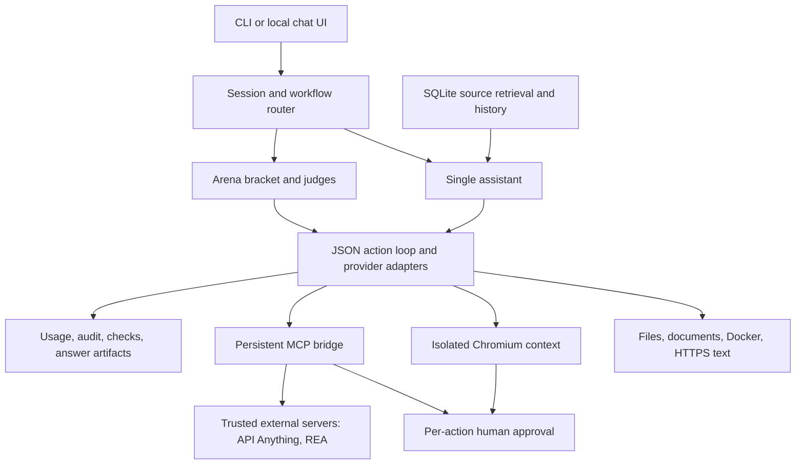

# Research and integration decisions

Goal: turn a Claude-plugin-specific tournament into a useful, provider-configurable assistant with real tools. The v0.3 design adds tools the model can call; it does not assume that possession of an API key supplies a browser, shell, memory, or reliable judgment.

## Source review

The following upstream snapshots informed the design. Commit links pin the reviewed source; later upstream releases may differ. No additional upstream runtime code or skill bundles were copied into the MIT application. The original Arena bracket, strategies, and rubric remain attributed under the existing MIT license.

| Project and reviewed source | License observed | What it provides | Integration decision |
| --- | --- | --- | --- |
| [Arena](https://github.com/Jakeschincariol/arena-skill/tree/df07b8e518e10cdecd8cd7712d9958b6f396250e) | MIT | Competitor strategies, attacks/defenses, judging, elimination bracket | Preserve the original bracket; add a provider-independent assistant/tool runtime around it. No Claude marketplace dependency. |
| [ECC](https://github.com/affaan-m/ECC/tree/6f1881aeafa3c48f7b603cc4be4b2e4e70daad59) | MIT | Agent roles, development workflows, instructions, harness-specific integrations | Adopt the design ideas of explicit roles, source inspection, evidence, and verification. Own small role instructions; no ECC hooks/plugin/skill execution imported. |
| [API Anything](https://github.com/goodnight000/api-anything/tree/daca03ac08238a91e22c53085c6d0c01310fc56b) | MIT | Learn website operations from observed requests; expose calls through CLI/TypeScript/MCP | Connect via persistent MCP using a concrete example selecting its four advertised tools. Require approval for generic operation dispatch and login. No automatic capture, package installation, or session import. |
| [REA](https://github.com/morluto/rea/tree/799e8265b254e225dc1dabdd25e56f0ab7f86bd3) | MIT | Analysis of binaries, local applications, runtime behavior, and saved captures via MCP/CLI | Add a pinned MCP registration example; discover exact names and enable an explicit subset. Provider/tool setup remains upstream. Do not misrepresent it as a Canva automation SDK. |
| [mimic](https://github.com/littledivy/mimic/tree/8cf998ac0b365806d8e522d34107cc504ecaa345) | MIT | mitmproxy-backed traffic/session capture and API client generation; its generation workflow uses Claude | Keep outside core. It adds certificate, capture, session, and model-specific requirements that a coding assistant does not need by default. Generated clients could later be exposed through a user-controlled MCP server; that adapter is not implemented here. |
| [MiroFish](https://github.com/666ghj/MiroFish/tree/7657031ac01184afe2cb220f5ee3545573b5e843) | AGPL-3.0 | Persona-based social simulations, graph/memory setup, scenario runs and reports; LLM and Zep configuration | Do not vendor into MIT core. A separately deployed service is a possible future adapter, subject to its license/deployment requirements. No MiroFish service calls or validated prediction capability are added. |
| [awesome-agents](https://github.com/kyrolabs/awesome-agents/tree/d565aa7857443adc4c24be3ef90aaf39c397e7f6) | No license declared in inspected GitHub metadata | Discovery catalog of projects, rather than an executable agent | Link for discovery; do not copy the catalog or assume its entries are compatible or audited. |
| [mirofish.co.in/simulate](https://www.mirofish.co.in/simulate) | Unverified | Hosted site supplied by the user | Could not verify this site's relationship to the upstream project. No keys sent, no automatic integration, and no claims about its hosting/privacy/licensing. |

Primary implementation references: [Playwright browser contexts](https://playwright.dev/python/docs/browser-contexts), [network interception](https://playwright.dev/python/docs/network), [Route API](https://playwright.dev/python/docs/api/class-route), and the [official MCP Python SDK v1](https://github.com/modelcontextprotocol/python-sdk/tree/v1.x). Optional dependency ranges are declared in `pyproject.toml`; tests exercised MCP 1.30.0 and Playwright 1.64.0 with Chromium 153 locally. CI uses Playwright's matching downloaded Chromium.

## Why composition instead of merging every repository

These projects do different jobs. A role/prompt library, a social simulator, an API recorder, an application-analysis toolkit, and a tournament are not interchangeable model skills. Combining their code trees would not produce a stronger model and would introduce conflicting runtimes, licenses, credentials, and state.

A narrow MCP boundary keeps optional systems separately installable and gives the assistant a discoverable tool catalog with explicit schemas. A native browser handles supported pages that lack a learned API. Local tools and context remain useful with neither installed. This also avoids making social-simulation infrastructure and traffic-interception certificates prerequisites for ordinary coding tasks.

## Runtime architecture

For a single assistant request:

1. Validate task, acquire the session lock, and choose a workflow. Reuse a filtered project copy rather than modifying the original checkout.
2. Index bounded source chunks locally, retrieve relevant file/line excerpts, and include bounded recent conversation history. There is no embedding API call.
3. Present the selected model with task, role, required result schema, and enabled tools. Its API response must be a JSON tool action or final answer.
4. Dispatch local calls, browser operations, or namespaced MCP calls. Return evidence as untrusted data. Browser interactions/configured MCP writes wait for approval; schema errors do not send a tool call.
5. Run the configured Docker verification command, if enabled, independently of the answer. Persist successful conversation context, output, usage, and audit evidence. Without checks the result needs review.

A tournament uses separate competitor copies and the existing challenge/defense/judgment loop. Attackers/judges do not receive browser/MCP write capabilities. External MCP side effects are not isolated by competitor copies, so avoid shared mutable services in competitive runs or approve each action deliberately.

## Failure handling and observed evidence

The implementation was tested with local fixtures, without hosted model credentials:

| Behavior | Evidence |
| --- | --- |
| Persistent conversation and edits | Deterministic provider double performs a real file edit in the session copy; the next turn retrieves its source and prior answer; original source remains unchanged. This tests orchestration, not model intelligence. |
| Browser capability | Actual Chromium renders JavaScript; fills and clicks update DOM; approved POST reaches the fixture; screenshots have valid PNG bytes; tab switching and console/network evidence work. |
| Browser boundary | Denied actions perform no mutation; timed unapproved POST is blocked; unapproved origins and redirected hops are blocked before contacting the destination. The redirect test caught and fixed a real interception bypass during development. |
| MCP stdio | Official SDK fixture stays alive across calls, preserving a counter; schema-invalid calls are rejected; explicitly mapped env is present and an unrelated test key is absent. |
| MCP Streamable HTTP | Official SDK fixture initializes a session and preserves state across consecutive calls; the client uses explicit headers/timeouts rather than ambient proxy configuration. |
| MCP write/error handling | Denied write does not create a file; approved write does; server `isError` becomes failed evidence; unknown tool names and external schema refs fail closed. Prefix-collision regression covers similarly named servers. |
| UI | Real Chromium submits a task, sees approval, approves it, and renders the result at a mobile viewport without page errors/horizontal overflow. HTTP tests reject CSRF, foreign Origin/Host, stale approval IDs, concurrent jobs, and path traversal. |
| Existing behavior | Original bracket and provider/tournament/resume/tool regression suite remains passing, including main-branch portability fixes. |

The CI matrix keeps the dependency-free Python 3.11/3.12/3.13 path and adds a Python 3.12 job that installs all extras plus Chromium and requires the integration tests. Optional local tests may skip if an extra/browser is missing; the required job fails instead.

Not exercised end-to-end: real Groq/Anthropic/OpenAI/Gemini/Ollama model reasoning, Docker daemon execution, full upstream API Anything/REA application behavior, authenticated third-party sites, MiroFish simulation, and mimic interception. Compatible schemas and tested transports do not prove those applications work for every task.

## Remaining distance from Claude Code and ChatGPT

| Capability | v0.3 | Remaining gap |
| --- | --- | --- |
| Different model APIs | Seven configured provider contracts, bounded repair/fallback | Not every model or provider feature; smaller models may fail the workflow or judge badly. |
| Coding tools | Filtered file operations, Docker execution, independent configured checks | No general host shell, interactive terminal, IDE diagnostics bridge, automatic git operations, or background process manager. |
| Browser | JavaScript/DOM, interactions, tabs, screenshots for people | No model vision, full desktop, persisted login profiles, unrestricted redirects, or upload/download workflows. |
| Memory | Local text retrieval and bounded conversation history | No semantic embedding retrieval, automatic long-context summarization, or cross-project knowledge service. |
| External integrations | Persistent stdio/HTTP MCP tool bridge and two concrete setup examples | Manual install/credentials/tool selection; no universal service adapter, OAuth UI, or automatic skill execution. |
| Product interface | Local chat UI, progress, text attachments, approval queue | No multi-user auth, token streaming, cancellation, hosted deployment, voice, or video. |
| Reliability | Validation, budgets, evidence, verification hooks, regression tests | No guarantee of factual correctness, secure sandboxing of trusted MCP programs, or benchmark parity with commercial assistants. |

Suggested next increments are vision-aware provider adapters, explicit cancellation and process supervision, browser profile management with consent, reproducible integration smoke tests against the actual upstream applications, and task-specific evaluation datasets. These are future work, not features claimed by this PR.
